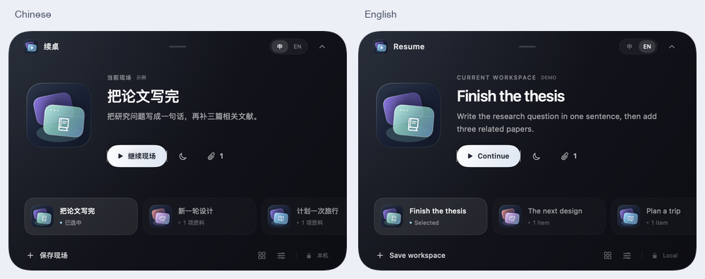

# XuZhuo · 续桌

**Save your workspace. Pick up where you left off.**

XuZhuo is a native macOS workspace saver that lives in a compact desktop island. Keep your files, links, supported window layouts, and next step together, then resume a project with one click. Local storage, no account required, and free under the MIT license.

[Download for macOS](https://github.com/gnpwvm28mg-eng/xuzhuo/releases/tag/v0.3.0) · [简体中文](README.zh-CN.md) · [Design references](docs/DESIGN_REFERENCES.md)



*Interface preview with demo workspaces. Switch between Simplified Chinese and English instantly.*

## A small home for unfinished work

- **Desktop island:** save, switch, resume, and leave a checkpoint directly from a floating capsule. The full gallery opens when you need it.
- **Workspace cards:** collect related resources, an optional desktop thumbnail, and a reminder of what to do next.
- **Drop to collect:** add files, folders, and web links while keeping the originals in place.
- **End-of-day checkpoints:** write one sentence about your progress before you leave.
- **Handoff packs:** export links, notes, and selected file copies for sharing.
- **Chinese / English:** switch from the island header, Settings, or the menu bar. The preference is remembered; your own titles and notes stay as written.

Version 0.3.0 introduces a redesigned glass-inspired island and independently drawn layered app icons. On macOS 26, supported controls use native Liquid Glass; macOS 14 and 15 use a compatible material. The app runs without a Dock icon and remains accessible from the menu bar.

## Install

The downloadable build requires **macOS 14 or later on Apple Silicon (arm64)**. An Intel binary is not included.

1. Download `XuZhuo-v0.3.0-macOS-arm64.zip` from the [v0.3.0 release](https://github.com/gnpwvm28mg-eng/xuzhuo/releases/tag/v0.3.0).
2. Unzip it and move `续桌.app` to Applications.
3. Open the app, then click the capsule near the top of your screen.

This is an early release with an ad-hoc signature. It is **not Apple-notarized**. If macOS blocks the app, review the message in **System Settings → Privacy & Security** and use the system's Open Anyway option if available.

Launch the app manually after signing in; automatic launch at login is not implemented yet.

## Use it

1. Choose **Save workspace**, give it a name, and write your next step. Add files, folders, or links as needed.
2. Select a workspace and choose **Continue** to reopen its resources and attempt to restore supported window positions.
3. Before stopping, leave a checkpoint so tomorrow's starting point is clear.
4. Open the gallery to organize cards, drop in more resources, or export a handoff pack.

Use **中 / EN** in the expanded island to change languages. Drag the top-center handle to reposition the island; click it to expand or collapse. The menu-bar entry can show the island, move it back to the top, open Settings, or quit the app. The three initial cards are examples.

## What gets restored

| Resource | Support |
| --- | --- |
| Web pages | Add or drop HTTP/HTTPS links and reopen them in your default browser. Optional tab collection supports running Safari and Google Chrome. |
| Files and folders | Store references to their original locations and system bookmarks; reopen files with their default apps and folders in Finder. |
| Window layouts | With Accessibility access, capture normal windows exposed by apps and attempt to restore their position and size. Matching uses the application and exact normalized window title. Capture skips hidden apps and minimized, fullscreen, or untitled windows; ambiguous restore matches are skipped. |
| Desktop thumbnails | With Screen Recording access, capture the main display while excluding XuZhuo's own windows. Without a capture, cards show an icon or a clearly labeled layout illustration. |
| Notes | Keep your next step and checkpoint history locally. |

Enable permissions as needed in Settings: **Automation** for browser tab collection, **Accessibility** for window layouts, and **Screen Recording** for thumbnails. Manually added resources and notes work without these permissions. System-owned permission dialogs follow your macOS language.

XuZhuo does not save unsaved documents, in-app editing state, browser tab groups, or the original browser window for each tab. Layout restoration depends on the app exposing adjustable windows and reopening them with recognizable titles. Windows from a disconnected display are moved into the current visible screen area.

## Local data

Workspace JSON and thumbnails are stored in:

```text
~/Library/Application Support/XuZhuo/
```

There is no cloud upload service. Adding or deleting a card does not move or delete the original files. Exported packs contain links, notes, and optional file copies; references that were not copied can retain local paths in `scene.json`, so review the pack before sharing.

## Build from source

Requires **Xcode 26 or later and its macOS SDK**. The package uses Swift 5 language mode and has no third-party dependencies. The newer glass API is guarded at runtime for earlier supported macOS versions.

```sh
git clone https://github.com/gnpwvm28mg-eng/xuzhuo.git
cd xuzhuo
swift test
./scripts/build-app.sh
open output/续桌.app
```

The build script draws the icon, builds the release executable, assembles the app, applies and verifies an ad-hoc signature, and creates app and source ZIPs in `output/`. It does not perform Developer ID signing or notarization.

## Validation status

The current automated suite has **28 tests: 27 passed, 1 intentionally skipped, 0 failed**. It covers persistence, failed-save recovery, resource deduplication, export handling, missing-resource reports, island placement, and localization. The screenshot fallback test skips when its process already has Screen Recording access to avoid capturing the desktop during the test.

Version 0.3.0 was checked on a real macOS desktop for capsule-only startup, the 480 × 340 expanded panel, the new icons and glass controls, and live language switching across the island and menus. Full save → checkpoint → restore → restart regression on the final build, Spaces/fullscreen behavior, and permission-enabled window restoration still need real-desktop validation.

## License and acknowledgments

[MIT](LICENSE). The interface and icon artwork are independently implemented. Design inspiration includes [boring.notch](https://github.com/TheBoredTeam/boring.notch), [NotchDrop](https://github.com/Lakr233/NotchDrop), [OnlySwitch](https://github.com/jacklandrin/OnlySwitch), and Apple's Liquid Glass direction. See [design references](docs/DESIGN_REFERENCES.md) for the review scope and attribution.
